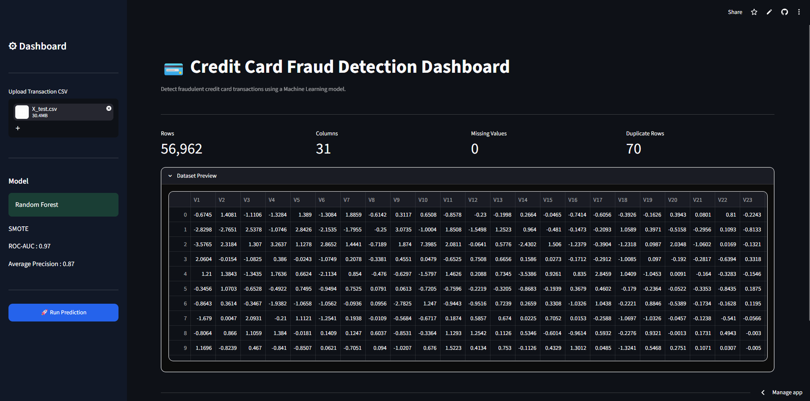
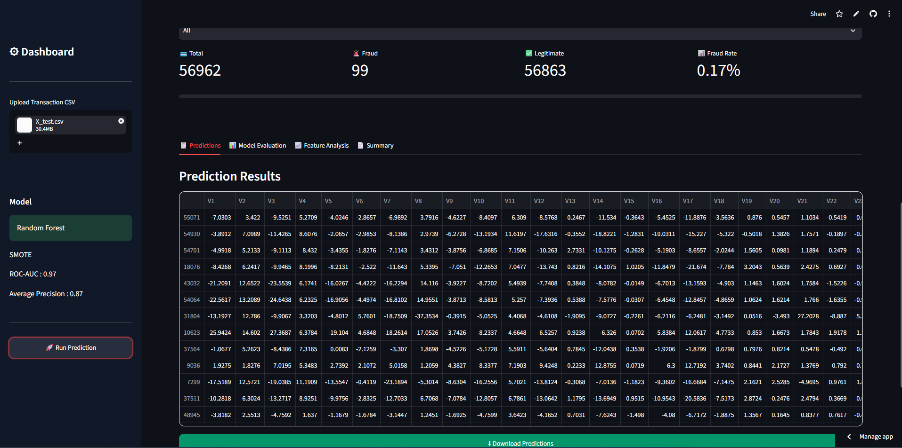

# 💳 Credit Card Fraud Detection using Machine Learning

An end-to-end Machine Learning project that detects fraudulent credit card transactions using a **Random Forest Classifier** trained on an imbalanced dataset. The project includes data preprocessing, SMOTE oversampling, model evaluation, feature importance analysis, and an interactive **Streamlit dashboard** for real-time predictions.

---

## 📸 Dashboard Preview

> Add screenshots after deployment.

| Dashboard | Prediction |
|-----------|------------|
|  |  |

---

# 🚀 Live Demo

**Streamlit App**

https://credit-card-fraud-jrvqt2glbkq6oj25dkuuqt.streamlit.app/

---

# 📂 GitHub Repository

https://github.com/sefatkhan2231-stack/credit-card-fraud

---

# 📊 Dataset

This project uses the **Credit Card Fraud Detection Dataset** from Kaggle.

Dataset Link:

https://www.kaggle.com/datasets/mlg-ulb/creditcardfraud

> **Note:** The dataset is not included in this repository because it exceeds GitHub's file size limit.

Place the downloaded dataset here:

```
dataset/
    creditcard.csv
```

---

# ✨ Features

- Data Cleaning
- Exploratory Data Analysis (EDA)
- Feature Engineering
- Handling Imbalanced Data using SMOTE
- Random Forest Classifier
- Hyperparameter Tuning
- Model Comparison
- Feature Importance
- ROC Curve
- Precision-Recall Curve
- Confusion Matrix
- Streamlit Dashboard
- Upload CSV for Prediction
- Fraud Probability
- Download Prediction Results

---

# 🛠️ Tech Stack

### Programming Language

- Python

### Data Analysis

- Pandas
- NumPy

### Visualization

- Matplotlib
- Seaborn
- Plotly

### Machine Learning

- Scikit-learn
- Imbalanced-learn (SMOTE)

### Dashboard

- Streamlit

### Model Serialization

- Joblib

---

# 📁 Project Structure

```text
credit-card-fraud/
│
├── dashboard/
│   ├── app.py
│   ├── charts.py
│   ├── config.py
│   ├── prediction.py
│   ├── utils.py
│   ├── requirements.txt
│   └── assets/
│       └── style.css
│
├── dataset/
│
├── notebooks/
│   ├── eda.ipynb
│   ├── feature_engineering.ipynb
│   └── model_training.ipynb
│
├── report/
│   ├── best_params.csv
│   ├── confusion_matrix.csv
│   ├── feature_importance_report.csv
│   ├── result_report.csv
│   ├── y_pred.npy
│   ├── y_prob.npy
│   └── y_test.npy
│
├── saved_models/
│   └── random_forest.pkl
│
├── README.md
└── .gitignore
```

---

# ⚙️ Machine Learning Pipeline

```
Load Dataset
      │
      ▼
Data Cleaning
      │
      ▼
Feature Engineering
      │
      ▼
Train/Test Split
      │
      ▼
SMOTE
      │
      ▼
Random Forest
      │
      ▼
Hyperparameter Tuning
      │
      ▼
Evaluation
      │
      ▼
Streamlit Deployment
```

---

# 📈 Model Performance

| Metric | Score |
|---------|-------|
| ROC-AUC | **0.97** |
| Average Precision | **0.87** |
| Precision | **0.83** |
| Recall | **0.84** |
| F1-Score | **0.83** |

---

# 📊 Dashboard Features

### Upload Dataset

Upload any transaction CSV file.

### Prediction

Predict fraudulent transactions using the trained model.

### Fraud Probability

View fraud probability for every transaction.

### Model Evaluation

- ROC Curve
- Precision-Recall Curve
- Confusion Matrix

### Explainability

Feature Importance chart.

### Download Results

Export prediction results as CSV.

---

# 🚀 Installation

Clone the repository

```bash
git clone https://github.com/sefatkhan2231-stack/credit-card-fraud.git
```

Move into the project directory

```bash
cd credit-card-fraud
```

Create a virtual environment

```bash
python -m venv venv
```

Activate it

### Windows

```bash
venv\Scripts\activate
```

### Linux / macOS

```bash
source venv/bin/activate
```

Install dependencies

```bash
pip install -r dashboard/requirements.txt
```

---

# ▶️ Run the Dashboard

```bash
cd dashboard

streamlit run app.py
```

---

# 📌 Future Improvements

- XGBoost Model
- LightGBM Comparison
- SHAP Explainability
- Real-time Fraud Detection API
- Docker Support
- Cloud Deployment
- Authentication
- Database Integration

---

# 👨‍💻 Author

**Md. Sefat Khan**

GitHub

https://github.com/sefatkhan2231-stack

LinkedIn

(Add your LinkedIn profile)

---

# ⭐ Support

If you found this project helpful, consider giving it a ⭐ on GitHub.
